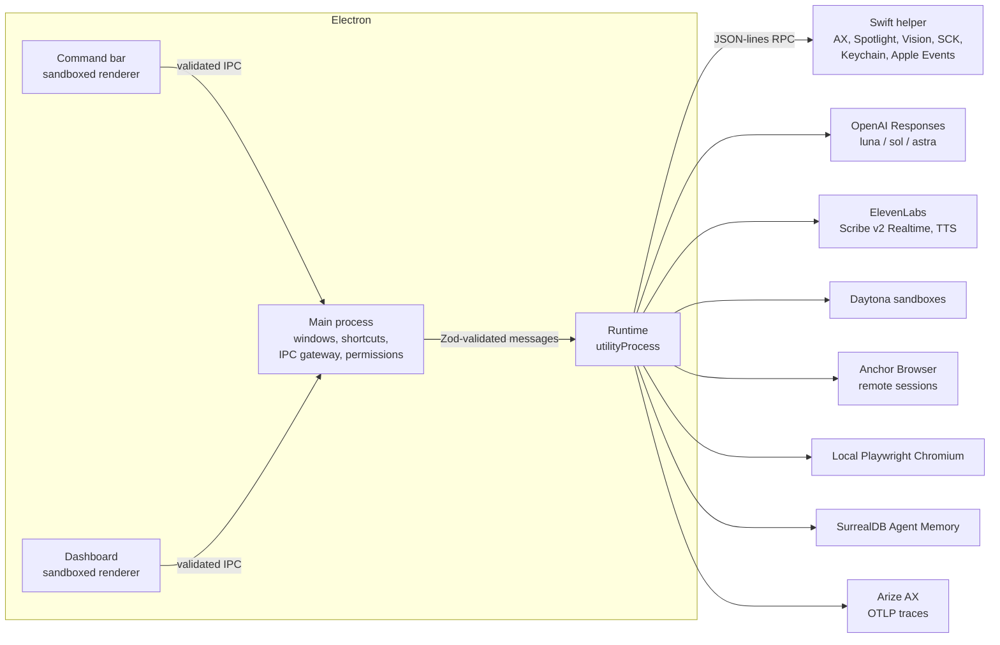
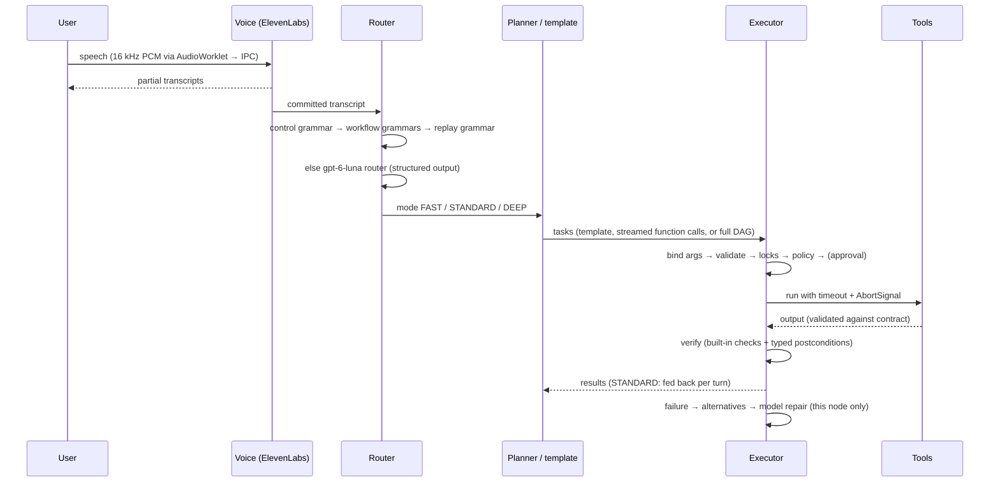

# CommandOS architecture

CommandOS turns a spoken or typed instruction into a verified sequence of actions on a Mac. It is
built around three ideas:

1. **Cheapest reliable path.** Deterministic code first (local grammars, templates, recalled
   procedures), one fast model call when needed, incremental planning for open-ended work, and deep
   reasoning only for risky, ambiguous or failing steps.
2. **Typed, verified actions.** Every action is a task with Zod-validated arguments, a policy
   decision, a timeout, an output contract and postcondition checks against real system state.
3. **The model never authorizes itself.** Risk comes from tool contracts and concrete arguments;
   approvals come only from the user.

## Processes



| Process | Responsibilities | Trust |
|---|---|---|
| Renderer (×2) | UI only. `sandbox: true`, `contextIsolation: true`, `nodeIntegration: false`, strict CSP, served from a privileged `app://` scheme. The preload exposes exactly `invoke`, `sendAudio`, `on`. | Untrusted |
| Main | Windows, global shortcuts (⌥Space bar, ⌃⌥Space voice, ⌃⌥Esc stop), IPC gateway (sender-frame checks, Zod validation in both directions), microphone/System Settings access, runtime supervision. | Trusted |
| Runtime (`utilityProcess`) | Routing, planning, execution, policy, approvals, audit, undo, checkpoints, voice, providers, credentials. Can be killed and restarted by emergency stop. | Trusted, holds secrets |
| Swift helper | Native macOS capabilities over typed JSON-lines RPC. Stateless; restarted lazily after crashes. | Trusted |

The runtime package is Electron-agnostic: the CLI (`pnpm cmd`), the tests and the benchmarks run
the exact same `CommandRuntime`.

## Command lifecycle



### Overlay (`apps/desktop/src/main/index.ts`, `views/CommandBar.tsx`)

The primary UI is a see-through overlay in the top-right corner: a non-activating macOS panel
at screen-saver level, on every Space and over full-screen apps, so the app CommandOS is driving
stays visible underneath. It shows the input, approvals, the live steps and the answer, and
sizes itself to its content. It cannot take keyboard focus until the user types in it (⌥Space
or a click in the input) and gives focus back on submit, Escape or blur, so keystrokes CommandOS
sends to other apps never land in it; its buttons work without focus. The dashboard (DAG,
history, settings) opens on demand.

### Routing (`packages/runtime/src/router.ts`)

| Step | Cost | Examples |
|---|---|---|
| Control grammar | 0 model calls | stop, cancel, undo, approve, deny, emergency stop |
| Workflow grammars | 0 model calls | screenshot organizing, “run the tests in ~/repo and fix the failures”, “do the same for …”, the draft purchase request on the partner portal |
| Everyday commands (`quick.ts`) | 0 model calls | “open Google Chrome and open Gmail and email myself hi”, “open Spotify”, “go to github.com”, “search Google for …”, “open my Downloads”: fixed steps in the spoken order; anything not fully understood falls through |
| Page questions (`page-question.ts`) | 0 router/planning calls; 1 content call | “open Luma and figure out how many hackathons I have this month”, “summarize this page”: open the signed-in browser → read the page → answer; mixed commands that change anything fall through |
| Photo attachment (`photo-attachment.ts`) | 0 model calls | “take a Photo Booth photo and upload it to Qwen, don't submit”: take photo → attach its saved path to the existing Qwen chat; the upload still requires approval |
| Direct STANDARD | 0 router calls | plainly safe commands: no deleting, sending, paying, web, code repair, UI control or vague clean-up wording (`matchDirectStandard`) |
| Fast router model (`gpt-6-luna`) | 1 call, sent twice (hedged) | everything else: intent, mode, slots, whether a full preview is required |

The router only chooses a path; it never grants permissions, and skipping it changes no safety
property: every task still passes the policy engine and approvals. Words that might mean
something risky keep a command on the router (false alarms cost only latency). Two identical
router requests go out at once and the first answer wins (`hedged()` in `openai.ts`); router
latency spikes are per request, so best-of-two cut the measured maximum from 10.8 s to 5.1 s.
While the router runs, Sol already starts planning speculatively; its tasks are held until the
router confirms STANDARD and discarded otherwise.

### Execution modes

| Mode | Planner | When |
|---|---|---|
| FAST | Deterministic templates (`templates.ts`) or a recalled procedure (`procedures.ts`) | known workflows with all inputs present |
| STANDARD | `gpt-6-luna` for directly routed commands, `gpt-6.1-sol` otherwise (`planner/standard.ts`) | open-ended multi-step commands |
| DEEP | `gpt-6-astra` full DAG with up to two repair rounds (`planner/deep.ts`) | genuinely ambiguous goals or work that needs careful reasoning first (code repair). Risk alone does not choose DEEP: every risky step waits for the user's approval in any mode |

**Incremental planning.** GPT-6 models emit one function call per response (measured: never more,
whatever `parallel_tool_calls`, strictness or prompting), so a function per tool would cost a
model round trip per step. The planner therefore acts through one strict batch function,
`schedule({tasks, finish})`: each task is `{task_id, title, depends_on, bind, call}` where `call`
is an `anyOf` over every registry tool (`{tool, args}` with the tool's strict schema, or
`{tool, args_json}` for the few schemas strict mode cannot express). The argument stream is parsed
incrementally (`planner/stream-json.ts`): each task is validated and added to the executor the
moment its JSON object closes, so execution overlaps generation. `bind` pipes upstream outputs
(`t1.output.files[*].path`) into arguments (a binding also implies the dependency), so a whole
chain fits in one call. `ai.write` lets that chain include writing (extract → write with the fast
model → save) without a turn spent reading, and `finish.answer_from` points at the task output
that answers a question (e.g. `t3.output.text`), so questions need no second turn either.
`finish` in the same call ends the run once every task succeeded and verified.

**Email.** “Email myself hi” and similar commands map to a fixed two-step template
(`emailPlan`): `gmail.compose` opens a filled-in Gmail draft in the user's Chrome from Gmail's
compose URL (“me” is resolved from Settings or Chrome's Gmail window titles), then `gmail.send`
passes the external-send policy, presses ⌘↩ and checks that Gmail closed the draft or showed
“Message sent”. Accessibility supplies draft and confirmation evidence first; screen capture/OCR
is the fallback. Images can be pasted into the draft. With upload metadata available, composition
waits for a new image, no upload/progress activity, and a stable ready state; older helpers retain
the three-second fallback. Sends to the user's saved address follow `confirmSelfEmail`.

**Browser readiness.** `browser.readPage` checks the requested URL before reading, accepts short
loaded pages immediately, and polls lazy lists until content settles instead of sleeping a fixed
900 ms per scroll. Earlier rows are retained for virtualized lists; exhausted scroll/character
budgets mark the result incomplete, and that flag is passed to the answer model.

**Qwen attachments.** `browser.attachFile` selects an existing Qwen tab in the user's Chrome,
enables web Accessibility, and reads only the front window (`ax.tree` scope `window`). It opens
the composer's attachment control and uses the native macOS file picker. The path is typed only
after native-dialog and focus checks; Return is limited to the verified Go To Folder field.
The tool waits for new attachment evidence in the composer and for upload progress to settle.
It never presses the chat's Send button. The selected conversation URL is checked throughout;
focus changes, unknown controls and unverified uploads stop the flow. Failures are non-repairable
to prevent duplicate uploads. Supported photo requests use a fixed two-task plan, and the general
planner is also instructed to use this tool instead of repeated UI/vision searches.

The regression suite covers this behavior using scripted Accessibility/file-picker state; the
current signed-in Qwen UI has not been live verified because Computer Use access to Chrome was
not approved in this session. See [verification evidence](../verification/qwen-attachment.json).
The on-device text-location fallback now activates its target app and retries one on-screen-window
miss, handling focus/Space changes after Photo Booth.

Controlled attachment timing (identical simulated Accessibility state, real wall-clock tool runs):
3,002 ms → 306 ms median for an immediately ready image, three runs per version. This measures
the removed fixed wait, not real Gmail network/upload speed; evidence is in
[`verification/interaction-latency.json`](../verification/interaction-latency.json).

**Latency controls.** Planning streams are hedged: two identical streams race and the first to
produce output wins; the other is cancelled before any event reaches the planner, so it can
never act. Planning fails fast: a rejected task or a runaway tool call stops the stream at once,
the tasks already scheduled finish, and the next turn starts from the real state with a note of
what happened. A run planned by the fast model escalates to the main model the moment a step
fails or is rejected. A failed step gets at most one model repair, on the fast model. OpenAI Fast mode (`serviceTier: 'fast'`, Settings → Models) applies to every
call. Measured with `pnpm bench` (live, output-checked): everyday commands p50 2.3 s from prompt
to done and 1.1 s to the first action; before this work the same commands took 5–21 s.

### Executor (`packages/runtime/src/executor.ts`)

A growing DAG: tasks may be added while others run. A task becomes runnable when every dependency
succeeded, its bindings resolve, its arguments validate against the tool's Zod schema and its
resource locks are free (`fs:<path>` with parent/child conflicts, exclusive `ui:frontmost`,
`app:<bundleId>`, `browser:<session>`, `sandbox:<id>`). Then:

1. **Policy** (`policy.ts`) → allow / require approval / deny.
2. **Approval** (`approvals.ts`) with the exact arguments; unanswered requests are denied on timeout.
3. **Preconditions**, then the tool runs under a per-task timeout and the run deadline.
4. The output must satisfy the tool's **output contract**.
5. **Verification**: the tool's own checks against real state plus typed postconditions.
6. Transient errors retry with backoff; then **selective recovery** (below).

Dry run executes read-only steps for real and previews every change.

### Selective recovery (`recovery.ts`)

Only the failed node is retried; upstream tasks are never re-run and nothing is re-planned.

1. The tool's deterministic **alternatives** (e.g. `web.fillForm` by visible label when CSS
   selectors break; `ui.press` re-lookup when an element ref is stale) — no model call.
2. **Model repair** escalating `gpt-6-luna` → `gpt-6.1-sol` → `gpt-6-astra`, only for repeatable
   steps, given the error, schema, attempt history and dependency outputs.

Every proposal is re-validated and goes through policy again.

### Tool routing ladder

| Tier | Mechanism | Examples |
|---|---|---|
| 1 | Direct APIs, filesystem, Spotlight, parsers, sandboxes, browsers | `fs.*`, `screenshots.find`, `docs.extract`, `sandbox.*`, `web.*`, `data.select` |
| 2 | Apple Events templates (never model-authored) and Shortcuts | `notes.create`, `textedit.newDocument`, `finder.selection`, `shortcuts.run` |
| 3 | Accessibility (AXUIElement) | `ui.snapshot`, `ui.find`, `ui.press`, `ui.setValue`, `ui.key` |
| 4 | Screen capture + on-device OCR / model vision | `screen.capture`, `vision.locateText`, `vision.ask`, `ui.click` |

## Contracts (`packages/contracts`)

Zod schemas shared by every process: tool descriptors, task/plan DAG, typed conditions, router
output, policy decisions and approvals, run events, voice events, settings, credentials, the
helper RPC (every method's params and result), the renderer↔main↔runtime IPC, the undo journal,
audit records and metrics. The Swift helper mirrors the RPC contract; a test asserts the method
sets match.

## Persistence

```
~/Library/Application Support/CommandOS/
  settings.json
  audit/audit.jsonl                 hash-chained, redacted
  traces/spans-YYYY-MM-DD.jsonl     local copy of every span (redacted)
  runs/<runId>/
    events.jsonl                    the run's event stream (UI history, metrics)
    summary.json                    written when the run ends (missing ⇒ interrupted)
    journal.jsonl                   undo operations
    checkpoints/tasks.jsonl         full task specs
    checkpoints/outputs/<task>.json verified outputs (resume)
    artifacts/                      captures, backups, screenshots
```

Credentials live in the macOS Keychain (`com.commandos.credentials`) via the helper; `.env.local`
is a development fallback.

## Memory (`procedures.ts`)

After a verified run, a procedure is stored verbatim in SurrealDB Agent Memory (`infer: none`) with
an environment fingerprint (tool contract hashes, app versions, site origins, OS). “Do the same
for …” recalls it, checks the fingerprint, re-binds parameters deterministically when the command
names them (zero model calls) or with one fast-model call, and replays it as a FAST plan. A failed
replay marks the procedure stale. Recalled procedures are also given to STANDARD/DEEP planners
as hints.

## Telemetry

The runtime registers an OpenTelemetry tracer provider at startup. Spans use OpenInference kinds:
`AGENT` (command), `CHAIN` (route, plan turns, recovery, undo, memory writes), `LLM` (every OpenAI
call, auto-instrumented), `GUARDRAIL` (policy), `TOOL` (each attempt), `EVALUATOR` (verification,
with `eval.verified` / `eval.checks_*`), `RETRIEVER` (memory recall). A redacting exporter scrubs
secrets, home paths and image payloads before export to Arize AX and to the local JSONL file.
