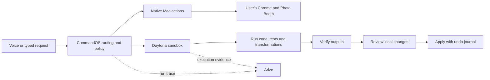

# Daytona documentation review for CommandOS

Reviewed October 16, 2026, using the [full documentation export](https://www.daytona.io/docs/llms-full.txt), generated October 12. The freshly downloaded file contains 3,136,236 bytes, 99,880 lines, 367,128 words and 189 top-level heading sections. Those sections include repeated language references and one 404 entry; they are not 189 distinct features.

The review covers the export's full structure and capability families, with detailed checks of the core guides and TypeScript contracts used by CommandOS. Repeated SDK examples were consolidated; the other SDKs were compared at the API-surface level. This is documentation research and a source audit, not live validation of every API or account entitlement. The [coverage record](daytona-review-coverage.json) contains source ranges and a SHA-256 fingerprint. The browser reader returned a shorter cached extraction, so these counts refer to the raw download.

## What Daytona should do in CommandOS

Daytona can supply a complete remote execution environment: files, processes, services, terminals, desktop interaction, persistent storage and previews. CommandOS currently uses a small part of that surface for repository tests and patch validation.

Recommended division of responsibility:

This is an architectural recommendation. The file-transformation return path and richer Daytona observability described below are prospective improvements, not implemented features.

## Capability map

| Area | Capabilities reviewed | Relevance to CommandOS |
|---|---|---|
| Authentication | API keys, JWTs, managed child keys, organization assignments | Keep credentials in the trusted runtime; understand the organization boundary. |
| Runtime classes | Default containers, Linux VMs, Windows, GPUs and a separate macOS offering | Choose the runtime required by the task rather than assuming every sandbox is interchangeable. |
| Lifecycle | Create, start, stop, pause, archive, delete, recover, resize, fork, linked sandboxes | Match cleanup and resume behavior to the class. |
| Deadlines | Idle stop/pause, stopped-time deletion, wall-clock TTL | Bound abandoned runs and distinguish inactivity from total lifetime. |
| Images and snapshots | Registry images, declarative builds, prepared environments, cold/hot captures | Move repeatable setup out of the interactive request. |
| Warm capacity | Snapshot/region-based warm pools and replenishment | Reduce provisioning time when enabled for the account. |
| Files and repositories | Transfer, streaming, metadata, search, Git, LSP | Use structured operations for staged inputs and verified outputs. |
| Execution | Shell commands, stateless code, persistent Python interpreter contexts | Pick the smallest execution mechanism for each job. |
| Sessions and terminals | Background commands, streamed logs, PTYs and interactive input | Show actual progress during long jobs. |
| Remote desktop | Mouse, keyboard, screenshots, recordings, display controls and Linux accessibility | Supports automation inside the sandbox desktop. |
| Human access | Web terminal, SSH, VNC, VPN connectivity | Useful for debugging and observing remote execution. |
| Previews | Authenticated service URLs, expiring signed URLs, custom proxying | Present generated applications or reports when useful. |
| Persistent storage | Shared volumes, per-tenant subpaths, external filesystem mounts | Cache suitable artifacts and preserve outputs beyond sandbox deletion. |
| Events and monitoring | Webhooks, SDK state events, logs, metrics, traces and analytics APIs | Connect lifecycle evidence to the existing run history. |
| Security and administration | Network policy, proxy-backed secrets, audit logs, organizations, SSO and SCIM | Relevant as the application grows beyond a personal prototype. |
| Operations | Resource quotas, rate limits, billing, troubleshooting and acceptable-use guidance | Inform resource budgeting and failure handling. |

The export also covers TypeScript, Python synchronous/asynchronous clients, Ruby, Go, Java, the CLI, and separate platform, toolbox and analytics API surfaces. The [official documentation navigation](https://www.daytona.io/docs/en/) provides the canonical pages for these areas.

## Local Mac control and remote computer use are different

The [Computer Use guide](https://www.daytona.io/docs/en/computer-use/) describes interaction with desktops inside Daytona environments. Its accessibility interface uses Linux AT-SPI. That is distinct from the macOS Accessibility helper in this repository.

The [sandbox guide's macOS section](https://www.daytona.io/docs/en/sandboxes/#macos-sandboxes) directs users to use.computer, a separate key and a reserved Mac. A remote Mac is still a different machine with different applications, files, devices and browser state.

Consequently, adopting Daytona computer use does not by itself connect to the user's existing Qwen session or physical camera. The current Photo Booth → local Chrome workflow should continue through the native Mac adapter. A remote desktop is useful for testing unfamiliar apps, running controlled GUI tasks, or demonstrating isolated automation with its own accounts and fixtures.

Also distinguish default containers from full VMs. The detailed [isolation documentation](https://www.daytona.io/docs/en/isolation/) describes container namespaces/resource limits and the separate VM boundary. Avoid claiming that every default sandbox is a full hardware VM.

## The useful speed features

### Prepared snapshots

[Snapshots](https://www.daytona.io/docs/en/snapshots/) let repeated runs start from an environment containing the necessary tools and dependencies. CommandOS currently creates a sandbox and then installs project dependencies during the request.

Recommendation: support an explicitly selected, versioned baseline snapshot. For project-specific dependency caching, identify the environment using the lockfile and runtime/toolchain versions. Keep changing project files separate from the reusable baseline. Measure how much time installation actually consumes before building a more complex cache.

The [declarative builder](https://www.daytona.io/docs/en/declarative-builder/) also documents a 24-hour image cache on the same runner. That should not be treated as guaranteed cache availability across runners or as a substitute for a managed snapshot strategy.

### Warm pools

[Warm pools](https://www.daytona.io/docs/en/warm-pools/) maintain running sandboxes for a snapshot and region. Eligibility also depends on default snapshot resources, the default user, and the absence of custom environment variables, volumes or secrets. Labels and network settings can be applied when a sandbox is claimed. The feature requires organization enablement and consumes quota while capacity is warm.

CommandOS has no warm-pool setup or explicit snapshot selection today. Start with a pool of one only if the organizer's account supports it and measurements justify it. Check ready capacity and errors before the demo. The documentation's startup claims are not an end-to-end latency measurement for CommandOS.

### Streaming and concurrency

The [process API](https://www.daytona.io/docs/en/process-code-execution/) separates ordinary command execution, background sessions and persistent interpreter contexts. Commands inside one session run sequentially; independent sessions provide concurrency. [Log streaming](https://www.daytona.io/docs/en/log-streaming/) exposes output while work is running, and [PTYs](https://www.daytona.io/docs/en/pty/) support interactive terminals.

Recommendation: stream installation and test output into the existing activity log instead of showing a long silent task. Preserve stdout, stderr and exit status as separate evidence. This improves responsiveness without claiming that the underlying tests run faster.

The [TypeScript overview](https://www.daytona.io/docs/en/typescript-sdk/) says recent SDKs already receive lifecycle events over a shared WebSocket with polling fallback. CommandOS's lockfile resolves `@daytona/sdk` 0.224.1. Check SDK behavior before adding another polling loop. Dependency files were not present during this review, so the installed implementation was not inspected.

## Lifecycle details that affect correctness

The [lifecycle guide](https://www.daytona.io/docs/en/sandboxes/#automated-lifecycle-management) distinguishes several clocks:

- Auto-stop is an inactivity timer; a running background process alone does not keep a sandbox active.
- Auto-delete counts stopped time. Zero means deletion on stop; it does not mean disabled.
- Wall-clock TTL limits existence regardless of current state.
- Ephemeral sandboxes are removed when stopped.
- Pause, in-memory forks and hot snapshots depend on the runtime class; ordinary containers do not support VM memory preservation.

The earlier provider configuration used `ephemeral: true` and `autoDeleteInterval: 0`, which made sandboxes disposable. The current configuration omits both settings, auto-stops after inactivity, and retains the sandbox until an explicit destroy request. It does not set a wall-clock TTL. A client timeout alone should not be assumed to establish remote resource cleanup.

The [TypeScript sandbox contract](https://www.daytona.io/docs/en/typescript-sdk/sandbox/#delete) states that `delete(timeout, wait)` defaults to returning when the request is accepted. Passing `wait: true` waits for destruction. CommandOS now uses that wait behavior.

## Concrete findings in this repository

The initial documentation audit identified the issues below. Subsequent implementation and live verification on October 16 corrected the first four; the remaining enhancements are prospective. See [provider results](../verification/report.json), [workflow results](../verification/demo-run.json) and [undo evidence](../verification/undo-live.json).

| Priority | Finding | Practical consequence | Recommended correction |
|---|---|---|---|
| Fixed | [Staging verification](../packages/tools/src/sandbox.ts) previously counted all files after dependency installation. | Installed dependencies could cause a false failure; equal totals could hide missing uploaded files. | Now checks every uploaded manifest path; regression tests cover extra dependencies and a missing source file. Content hashes remain a possible stronger check. |
| Fixed | [Cleanup](../packages/providers/src/daytona.ts) previously discarded handles before deletion completed. | A failed request lost its retry handle and an accepted request could be reported as completed. | Now retains handles, coalesces concurrent requests and uses `delete(60, true)` to confirm destruction. |
| Fixed | [Bulk cleanup](../packages/providers/src/daytona.ts) previously counted attempts and suppressed errors. | Cleanup claims could exceed confirmed deletions. | Now surfaces aggregate failures, retains failed handles for retry and counts completed deletions; the runtime logs failures. |
| Fixed | [Provider verification](../scripts/verify-providers.ts) previously accepted a reachable outbound probe. | A successful row could contradict its network-restriction claim. | Now asserts the probe result and uses Keychain API URL/target settings; a live probe passed. This is evidence for that destination, not a universal network proof. |
| Medium | [Creation configuration](../packages/providers/src/daytona.ts:38) has no snapshot, warm-pool integration or wall-clock TTL. | Setup remains on the request path; idle cleanup is the fallback after a client crash. | Add measured snapshot selection and a bounded lifetime appropriate to the run. |
| Medium | [Execution](../packages/providers/src/daytona.ts:74) returns only completed command output. | The UI cannot show the real intermediate test/install output through this adapter. | Introduce session-based execution with streamed logs where it materially helps. |

Additional correctness point: default shell execution may use zsh, and tools can observe host CPU counts rather than sandbox limits. The [process reference](https://www.daytona.io/docs/en/typescript-sdk/process/) recommends quoting shell arguments and sizing worker pools from allocated sandbox resources. Do not blindly use host-derived automatic test concurrency.

## Networking, secrets and organization boundaries

[Network policies](https://www.daytona.io/docs/en/network-limits/) are tier-dependent. Tier 1/2 organization restrictions take precedence; the documentation describes strict per-sandbox allowlists/block-all behavior for Tier 3/4. Registry access and an effective deny-all policy must be demonstrated on the actual hackathon account. Once installation is finished, a supported account can change outbound policy without restarting the sandbox.

[Secrets](https://www.daytona.io/docs/en/secrets/) use placeholders that a proxy substitutes in outbound HTTPS headers. This is useful if future in-sandbox tools need provider access. It does not mean that arbitrary environment credentials, request bodies or encoded passwords are protected automatically. Host allowlists are essential to the intended protection; Basic Auth requires the documented encoding approach. CommandOS's current choice to keep its model credential in the local runtime avoids needing to inject that key for its existing test workflow.

[Authentication scopes](https://www.daytona.io/docs/en/api-keys/) govern resource operations, but the docs state that an organization-valid key can access running sandboxes through the toolbox even without resource-management scopes. Do not design tenant isolation around sandbox labels or a narrowly scoped key alone. Resolve the trust boundary before exposing a shared organization's sandbox credentials to users.

For a demo preview, the [preview guide](https://www.daytona.io/docs/en/preview/) distinguishes standard sandbox-wide credentials from expiring, revocable, port-bound signed URLs. Use the latter for sharing a generated app or report. A standard preview token can grant substantially more than access to the visible app port.

## Storage, observability and larger features

[Volumes](https://www.daytona.io/docs/en/volumes/) can preserve data independently of sandbox deletion and isolate mounted prefixes using subpaths. They use FUSE/object storage, have concurrency semantics unlike a transactional database, and are slower than local sandbox disk for some workloads. Keep active tests on local disk; evaluate volumes for suitable caches and artifacts. The export also covers S3, R2, Tigris, Supabase, GCS, Azure, Box, Archil, MesaFS and TiDB filesystem mounts. These are options for future workloads, not prerequisites for the current prototype.

[OpenTelemetry collection](https://www.daytona.io/docs/en/observability/otel-collection/) describes two paths: tracing SDK calls in the application and collecting telemetry inside sandboxes. Integrating that evidence with CommandOS's Arize run trace could make sandbox startup, transfer and execution time inspectable. Check provider/context/exporter interaction and redaction before enabling another tracing setup; confirm the resulting parent-child relationships in the UI. Sandbox telemetry retention and collector overrides also need deliberate configuration.

[Webhooks](https://www.daytona.io/docs/en/webhooks/) are useful for a hosted service tracking lifecycle changes. A local prototype behind a laptop network should first use the SDK's existing event support; adding a public receiver is a separate architecture decision. The review also covered managed/dedicated regions, BYOC, SSO/SCIM, audit, quotas, billing, error families and acceptable-use requirements. None is required merely to demonstrate the existing repository workflow.

## Integration-guide lessons

The guide collection includes coding harnesses, data/SQL agents, desktop drawing, application builders, GPU serving, recursive models and reinforcement-learning environments. Common patterns include a controller outside the sandbox, execution inside it, streamed progress, explicit output collection and cleanup.

For CommandOS, the useful lesson is to strengthen its current controller/executor boundary. Switching the whole project to a different agent framework would introduce migration work without establishing a user benefit.

The next useful Daytona feature beyond repository repair would be a controlled artifact round trip: select local inputs, stage an explicit manifest, run a transformation remotely, download verified outputs, review the destination changes and apply them with undo. A preview can make an HTML output visible. This is a proposed extension, and would need new contracts, permissions and end-to-end evidence.

## Recommended order

1. Completed: correct staging verification and truthful cleanup reporting.
2. Completed for the controlled fixture: live create/upload/test/patch/re-test, a blocked outbound probe, confirmed cleanup, local passing tests and exact source restoration by undo.
3. Measure creation, transfer, dependency installation, model time and tests separately.
4. Add a prepared snapshot; enable a small warm pool only if available and justified.
5. Stream real output and connect the sandbox evidence to Arize.
6. Consider artifact transformations or remote GUI work after the existing path is reliable.

These findings refine the [hackathon brief](hacksprint-research-2026-10-16.md). They do not establish that a Daytona feature will remove latency from native Chrome or Photo Booth interactions, which use a separate execution path.
