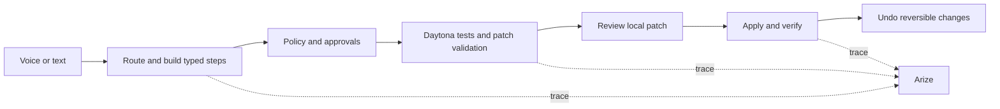

# CommandOS — Daytona HackSprint research and competition brief

Researched October 16, 2026, and updated with the organizer's Hacker Resources document supplied in the conversation. Public event pages and official product documentation were checked against this repository. Resource-document requirements below are attributed to that supplied document; recommendations are strategic judgments, not organizer instructions. No accounts were registered, credits redeemed, submissions published, or messages sent.

## Recommendation

Present CommandOS as **a voice-driven Mac agent that verifies its work, asks before consequential changes, and can undo reversible actions**. Lead with one complete outcome for a specific user: a developer fixes a broken local project through a reviewed, sandbox-tested patch.

Prioritize the main competition, Best Use of Daytona, and Best Use of Arize. ElevenLabs supports the same story naturally. Keep Anchor and SurrealDB as additional demonstrations only after their cloud paths work reliably. This ranking reflects fit with the existing implementation, not predicted award odds.

Treat the Devpost entry as the first judged product: it selects the eight finalists. Prepare the required public GitHub link and description early, and include the strongly recommended recording under two minutes. Sponsor awards remain available to all participating teams, so a focused sponsor demonstration still matters without a finalist slot.

Live checks now verify all six providers, using credentials saved in CommandOS's macOS Keychain store. The six controlled demo workflows passed, including actual cloud memory replay, Daytona repair and Anchor form filling; the built Electron app also passed model-command and voice-IPC checks. Remaining presentation work is a timed stage rehearsal, the physical microphone in venue conditions, and confirming the exported Arize trace in its dashboard. See [provider evidence](../verification/report.json), [desktop evidence](../verification/desktop-live.json), [demo evidence](../verification/demo-run.json), and [saved project status](../STATUS.md).

## Confirmed event facts

| Item | Confirmed information |
|---|---|
| Event | Daytona HackSprint w/ Arize AI, NYC, Friday October 16, 2026 |
| Venue | JFK27 Basement, 12 W 39th St, New York |
| Entry | Luma registration and a physical ID are required, per the supplied Hacker Resources |
| Team | Solo or up to four people |
| Build focus | AI agents with reasoning, independent decisions and safe tool integration |
| First round | Devpost submissions determine eight finalists |
| Final round | Three-minute pitch and demo, followed by two minutes of Q&A |
| Submission assets | Public GitHub repository URL; project description and team information; recording under two minutes highly recommended |
| Sponsor awards | Partners may choose winners from all participating teams, including teams outside the eight finalists |

Sources: [organizer event page](https://luma.com/hacksprint-nyc) and [official Devpost overview](https://daytona-hacksprint-nyc.devpost.com/). The organizer announcement supplied in the conversation also says approved attendees must arrive on time.

All times below are New York time, EDT:

| Time | Milestone |
|---|---|
| 9:00 AM | Doors, breakfast and coffee |
| 9:30 AM | Opening remarks and partner demos; Devpost submission window opens |
| 10:00 AM | Hacking begins |
| 12:30 PM | Lunch |
| **3:30 PM** | **Strict project submission deadline** |
| 4:00 PM | Finalist presentations and judging |
| 4:45 PM | Awards |
| 5:00 PM | Close |

The [Devpost schedule](https://daytona-hacksprint-nyc.devpost.com/details/dates) confirms a 9:30 AM–3:30 PM submission window. The remaining agenda is on [Luma](https://luma.com/hacksprint-nyc) and in the announcement you supplied. A submission window opening before hacking does not establish permission to build beforehand.

**Resource-document discrepancy:** its schedule heading says “Friday, July 24th,” despite the October event title, and its judging section refers to guidelines being shared on Tuesday. These appear to be leftover template text. Use the official October 16 schedule above; the July heading does not establish a different deadline.

## What judging rewards

The [official rules](https://daytona-hacksprint-nyc.devpost.com/rules) assign equal weight to four criteria and describe sponsor integration as a bonus. They do not specify the bonus's size.

| Criterion | Weight | What CommandOS should demonstrate |
|---|---:|---|
| Impact potential | 25% | A clear user and completed task: a Mac developer gets a tested fix without manually coordinating terminal, editor and agent output. Measure the workflow before claiming time saved. |
| Technical execution | 25% | Real execution, verified test results, exact patch review, successful local application and undo. |
| Creativity | 25% | How the execution design combines typed plans, native actions, selective recovery and reversible changes. Explain why that combination helps the user. |
| Presentation | 25% | A readable before/after, one narrative and a rehearsed three-minute demonstration. |
| Sponsor tool usage | Bonus | Explain the necessary job each sponsor performs and show evidence it happened. |

Interpretation: a coherent demo deserves at least as much attention as an additional integration. The published criteria do not award points simply for the number of sponsor logos.

## Eligibility questions and remaining missing links

The supplied Hacker Resources resolves the public-repository requirement, recording recommendation, finalist count and Q&A duration. These points remain unresolved:

1. Whether pre-existing code is eligible, and what must be created during the sprint. CommandOS already exists before the advertised hacking start. Ask at check-in and disclose the starting baseline and event-day additions.
2. Whether a particular repository license or hosted interactive demo is required. A public GitHub URL is explicitly requested; a recording under two minutes is highly recommended rather than stated as mandatory.
3. Whether setup counts against the three-minute pitch and whether a backup recording is allowed during a technical failure. Q&A has its own two-minute allocation.
4. Whether awards can be combined and whether sponsor categories require separate selection or evidence. Eligibility for sponsor consideration is not limited to finalists.
5. Redemption/account conditions not specified in the resource document and the actual AWS lab access destination. Anchor's stated redemption deadline is October 19.

The resource contents are now available. AWS Lab access and the Arize Hacker Starter Pack still have link labels without destinations. The subsequently supplied [Anchor + Daytona guide](https://docs.anchorbrowser.io/integrations/sandboxes/daytona) resolves the browser onboarding link; its credit instructions direct the human to Anchor Billing → Starter. Organizer support is the announced `#hacksprint-nyc-oct` channel via [Daytona Slack](http://go.daytona.io/slack). No organizer contact was made.

Suggested organizer question: “CommandOS has an existing desktop runtime. May I enter if I disclose the baseline and demonstrate work completed during today's sprint? Do sponsor categories need separate selection, and can awards be combined?”

The judge rosters on Luma and Devpost differ, including the Anchor representative. Use the published rubric to prepare; do not build a strategy around an assumed individual judge's preferences.

## Prize fit and sponsor research

The prize amounts here come from the announcement you supplied and are corroborated by the [official prize listing](https://daytona-hacksprint-nyc.devpost.com/). They are advertised awards, not eligibility guarantees.

| Target | Advertised special award | Existing integration | Evidence to obtain |
|---|---|---|---|
| **Daytona — first priority** | $1,000 cash + $10,000 credits | Repository staging, sandbox tests, patch application in sandbox, re-test, reviewed local patch | A real sandbox ID, initial failures, passing re-test, effective network restrictions, deletion confirmation |
| **Arize — first priority** | $500 cash + one year AX Pro | OTel/OpenInference spans for agent, model, tool, policy, verification and recovery | A trace visible in AX matching the live run; meaningful quality results rather than a successful export alone |
| **ElevenLabs — supports primary demo** | Three months Scale per team member | Scribe v2 Realtime input and spoken verified summaries | Actual microphone transcript, correct committed command and measured speech-end-to-commit latency |
| SurrealDB — optional second story | $500 cash + $1,000 Agent Memory credits + swag | Store verified procedures, recall, deterministic parameter binding and replay | Live replay plus a typed, time-aware fact correction with preserved history and source provenance; the latter is proposed work |
| Anchor Browser — optional alternate demo | $500 cash + $5,000 credits | Remote browser, Playwright/CDP, form read-back, redesign recovery | Remote session ID/live view; correct fields, no submission, cleanup |
| AWS — low incremental priority | Twenty $75 AWS credit gift cards | No direct AWS integration identified in the inspected provider layer | Ask for award conditions; use lab access if it helps an actual requirement |

Main cash prizes are $3,000 / $1,000 / $500, with additional credits and benefits. Award stacking is unconfirmed. Avoid adding AWS infrastructure solely to add a logo.

### Participant resources and activation paths

The following offers and redemption steps come from the supplied Hacker Resources. Voucher values are kept in the conversation rather than duplicated in this public-repository brief. Redeeming a credit does not configure the corresponding runtime API credentials.

| Partner | Participant offer | Stated activation path |
|---|---|---|
| Daytona | $100 credits | Create an account at [app.daytona.io](https://app.daytona.io); Billing → redeem the supplied event coupon |
| Arize | Three months AX Pro, advertised $150 value | [Arize AX](https://app.arize.com) → Settings → Billing → Pro; use the supplied event checkout code |
| ElevenLabs | One month Creator, advertised $22 value | Join the supplied [Discord](https://discord.com/invite/VnBvbbcdEC); coupon-codes channel → Start Redemption → select the event and use the registration email; the bot provides a unique coupon |
| AWS | Lab accounts | Request access at the event; the pasted lab-link destination is missing. The document describes a one-time password sent by email |
| SurrealDB | $50 Agent Memory credits | [SurrealDB Studio](https://studio.surrealdb.com) → Billing → redeem; Agent Memory → deploy a context with a name and region |
| Anchor | $200 credits | Use the supplied event coupon; **redeem by October 19**. The event-specific redemption URL was not included |

For SurrealDB, the supplied [hosted quickstart](https://surrealdb.com/docs/agent-memory/quickstarts/hosted), [SDK reference](https://surrealdb.com/docs/agent-memory/reference), [integrations](https://surrealdb.com/docs/agent-memory/integrations) and [migration cookbooks](https://surrealdb.com/docs/agent-memory/cookbooks) are direct technical entry points. The resource also links an optional skill installer; no skill was installed as part of this review.

### Daytona: make isolation essential to the outcome

The implementation in [daytona.ts](../packages/providers/src/daytona.ts), [sandbox tools](../packages/tools/src/sandbox.ts) and [workflow template](../packages/runtime/src/templates.ts) already supports a strong explanation: untrusted repository code executes remotely; the candidate patch must pass tests there before local review.

[Daytona's firewall documentation](https://www.daytona.io/docs/en/network-limits/) describes block-all and allowlist settings, with enforcement affected by organization tier. Tier 1/2 organization policy takes precedence and essential services remain reachable; strict custom policies are described for Tier 3/4. Confirm the hackathon account's actual behavior with Daytona support before saying all outbound traffic is blocked. A failed fetch to one hostname establishes only that probe's result.

**Verification fixes completed:** [verify-providers.ts](../scripts/verify-providers.ts) now rejects an unexpectedly reachable outbound probe and uses the configured Keychain API URL and target. Sandbox cleanup waits for confirmed destruction, retains failed handles for retry and reports failures. A blocked probe establishes that probe's result, not comprehensive proof that every destination is blocked.

For startup speed, [Daytona snapshots](https://www.daytona.io/docs/en/snapshots/) can preserve dependencies, and warm pools can supply already running sandboxes. These are possible follow-ups; the current provider creates sandboxes without a configured warm pool. First measure creation, upload, model and test time separately. The small dependency-free fixture is a practical first live rehearsal.

The separate [full Daytona reference review](daytona-reference-review.md) covers the complete supplied LLM export and records which staging, cleanup and verification issues were subsequently fixed. Prepared snapshots, warm pools and richer execution streaming remain prospective improvements.

### Arize: show what evaluation changed

[Arize tracing](https://arize.com/docs/ax/instrument/what-are-traces) uses OTel and OpenInference to expose nested operations and timings. CommandOS emits that structure and locally records redacted traces. The live provider report now confirms accepted cloud exports, and the built Electron runtime reports Arize enabled. Dashboard visibility and configured quality evaluations remain separate checks.

An `EVALUATOR` span is instrumentation. It does not by itself establish that an Arize evaluator or experiment is configured. [Arize evaluators](https://arize.com/docs/ax/evaluate/create-evaluators) produce labels, scores and explanations; [running evaluations on traces](https://arize.com/docs/ax/evaluate/run-evals-on-traces) is a separate step.

Recommended small evaluation set, clearly labelled as proposed work:

- Completion: requested artifact exists and task-specific checks pass.
- Approval: protected changes did not happen before approval.
- Undo: reversible fixture changes restore the original contents exactly.
- Recovery: the failed step is repaired without replaying successful dependencies.

Use deterministic checks for filesystem state, approvals and tests. Reserve a model judge for subjective answer quality. Include a deliberate failure and its explanation. Attach results to the corresponding run or experiment in AX using a supported evaluation path; verify that the UI displays them. Show one improvement supported by those results.

### ElevenLabs: prove the voice experience in the room

[Scribe's realtime API](https://elevenlabs.io/docs/api-reference/speech-to-text/v-1-speech-to-text-realtime) supports partial and committed transcripts, manual commits and VAD segmentation. Its silence threshold trades segment length against commit delay. CommandOS already supports manual/VAD modes and records timing.

Rehearse with the actual microphone and venue noise. Manual commit is a useful fallback if VAD clips a path or waits too long. Do not execute partial transcripts as final commands. Keep spoken results brief and based on verified outcomes. A microphone-to-action measurement includes capture, transcription, commit, routing and execution; an API transcription latency claim measures only part of that path.

### Anchor: distinguish the cloud session from the user's browser

[Anchor session creation](https://docs.anchorbrowser.io/api-reference/browser-sessions/start-browser-session) returns a session ID, CDP endpoint and live-view URL. Its [live-view guide](https://docs.anchorbrowser.io/quickstart/embed-browser-in-your-product) provides a visible demonstration surface. CommandOS's remote Anchor path and its local Chromium fallback are distinct implementations; a successful local fixture run does not verify Anchor.

The Hacker Resources recommends running the **agent code in Daytona and the browser in Anchor**. CommandOS currently orchestrates both providers from the local Mac; using each provider in separate workflows does not establish that recommended joint architecture. Treat it as an optional architecture improvement, not an eligibility rule. If built, show the browser-control worker executing inside a real Daytona sandbox and connecting to the Anchor session, while the Mac retains its native actions.

If this becomes the chosen demo, fill the controlled purchase request, verify the cheapest eligible product and all field values, show that it was not submitted, then demonstrate a redesigned layout and inspect the recovery trace. A public fixture avoids needing personal logins. [Persistent profiles](https://docs.anchorbrowser.io/essentials/authentication-and-identity) exist but are unnecessary scope for that example.

### SurrealDB: align the demo with typed, time-aware memory

[Agent Memory](https://surrealdb.com/docs/agent-memory) is a memory layer backed by SurrealDB. Its documentation explains that the old `SPECTRON_*` configuration names remain during the rename. The existing names in CommandOS are therefore not, by themselves, evidence of an obsolete integration.

CommandOS stores literal, validated procedure records and retrieves them for application-controlled replay. It does not train model weights. Describe this as **remembering and reusing a verified procedure**. Scope records per user, reject secrets and validate the recalled plan before acting. Live store/recall and a changed-input replay must pass before claiming cloud memory works. The pinned alpha SDK makes a real round trip especially valuable.

The supplied sponsor criteria specifically emphasize typed, time-aware memory: superseding facts rather than overwriting them, retrieval traced to its source, or memory shared across agents. Current [memory.ts](../packages/providers/src/memory.ts) writes procedure JSON with `infer: 'none'`. It now resolves chunked search hits to their complete original turns and can read a known procedure directly from its saved cloud source reference; runtime pointers track newer versions and stale invalidations. That demonstrates source-backed procedural reuse, but does not by itself demonstrate Agent Memory's typed fact reconciliation or point-in-time fact retrieval.

**Proposed focused extension, not implemented:** remember that the demo project's output folder is `Sorted`, then record an explicit correction to `Reviewed` in the same scope and provenance stream. Show the typed project attribute, current value, previous value and source for each correction; execute the next supported task using the current value. Ordinary policy checks still apply. [SurrealDB's reconciliation documentation](https://surrealdb.com/docs/agent-memory/reasoning/reconciliation-and-supersession) describes same-provenance supersession with preserved history and confidence conditions; conflicting sources can instead coexist as an uncertainty. Verify the actual API round trip and history before making this claim on Devpost.

## Competitive positioning

This is a focused comparison of published capabilities, not an exhaustive market survey or comparative benchmark.

| Existing product/category | Publicly documented overlap | Consequence for the pitch |
|---|---|---|
| [Raycast AI Extensions](https://manual.raycast.com/ai/ai-extensions) | Natural-language tool use across extensions, multi-tool requests and permission controls | A command bar plus AI tools is already familiar. Demonstrate the execution and verification behavior. |
| [Claude Cowork](https://claude.com/product/cowork) | Work across files and tools, visible progress, browser tasks and concurrent work | “An AI that organizes your files” is too broad to carry the originality claim. |
| [Anthropic computer/browser tools](https://platform.claude.com/docs/en/agents-and-tools/tool-use/computer-use-tool) | Desktop actions; the linked browser tool also uses page structure and screenshots | Do not claim competitors all rely exclusively on screenshot clicking. Show the concrete route chosen for this task. |
| [Open Interpreter](https://www.openinterpreter.com/docs/terminal) | File edits, command execution, sandbox/approval controls and resumable work | Approval and sandboxing alone are not unique. Explain the complete local execution design and demonstrate its outcome. |

Defensible wording: “CommandOS compiles spoken Mac tasks into typed execution steps, checks the resulting state, and keeps reversible changes undoable. Models handle ambiguity and content; supported operations can run directly.”

Avoid “first,” “fully autonomous,” “works with every app,” “completely private,” “always reversible,” or “faster than competitors.” The inspected implementation and benchmarks do not establish those claims. Cloud reasoning and sponsor features transmit selected data; OCR and native actions can run locally.

Initial audience recommendation: Mac developers who move between editor, terminal, browser and files. It is a specific launch audience, not evidence of validated demand. After the sprint, observe several users doing the same workflow manually and with CommandOS; measure completion, intervention, mistakes and willingness to keep using it.

## Three-minute presentation plan

Use this primary sequence only after live Daytona, ElevenLabs and Arize rehearsals succeed. The existing [technical demo](demo-scenario.md) is approximately ten minutes and must be shortened for judging.

| Time | Show and say |
|---|---|
| 0:00–0:20 | “Delegating work on your Mac should come with proof and control.” Identify the developer and broken project. Show the failure before starting. |
| 0:20–0:35 | Speak: “Run the tests in my CommandOS demo calc-lib and fix the failures.” Show the committed transcript and planned steps. |
| 0:35–1:30 | Approve staging when asked. Show the real Daytona sandbox, failing tests, proposed patch and passing re-test. Explain that repository code runs there. |
| 1:30–1:55 | Show the diff and approve local application. Point to the resulting changed files and completed verification. |
| 1:55–2:15 | Undo and show restored contents. Explain the boundary: local reversible edits, not arbitrary external actions. |
| 2:15–2:40 | Open the matching Arize trace. Show the tool/model/test checks and one actual quality result if configured. |
| 2:40–3:00 | State the user benefit, one honestly scoped measurement and next validation step. |

This is a timing budget, not a measured demo duration. If the live run cannot consistently fit, shorten the narration or choose the fallback; do not conceal a prerecorded run as live.

The two-minute Q&A follows this three-minute slot. Rehearse concise answers about the existing-code baseline, actual sponsor execution, failure recovery and what was verified.

Three slide outlines: (1) user problem and before/after; (2) execution flow with approval and verification boundaries; (3) measured evidence, sponsor roles and current limitations. Keep implementation detail off the main slide unless it explains a visible behavior.

Fallback: use the already evidenced screenshot organize → report → undo workflow, or local browser redesign recovery. Explain which parts are local and which cloud integrations remain unverified. Prepare a clearly labelled backup recording after a successful real run; confirm the organizer's policy for using it. The current page-question feature is a useful booth demo but is a weak centerpiece for demonstrating Daytona.

## Evidence and measurement discipline

| Existing evidence | Honest statement | Limit |
|---|---|---|
| [Benchmark report](../bench/results/latest.md): 15 everyday command runs | p50 completion 2.27 s; p50 first action 1.11 s in that recorded set | Specific commands, machine, model configuration and small sample; not the sandbox/voice workflow |
| Same report: five parallel fixture runs | DAG p50 633 ms versus 1,207 ms sequential, about 1.91× | Fixture workload; not a product-wide speedup or competitor comparison |
| [Interaction latency](../verification/interaction-latency.json) | An immediately ready simulated Gmail attachment took 306 ms median versus 3,002 ms before, three samples per version | Simulated Accessibility state; no real Gmail network or upload |
| [Page question latency](../verification/page-question-latency.json) | One live-model run completed in 2.65 s with one content call | Simulated browser page, one sample; not a real browser latency distribution |
| [Provider report](../verification/report.json) | Native helper and all six providers made successful live checks | Individual checks are supplemented by demo and desktop evidence; they do not cover every app or external site |
| [Replay speed](../verification/replay-speed.json) | Three live fixture replays started their first action in 162–489 ms, median 265 ms, after direct source lookup | Earlier semantic-search path took 7,744 ms in one live sample; this is a small controlled set, not a product-wide speedup |

Do not put “6 ms screenshot intelligence” on a slide: the very fast deterministic fixture benchmark excludes the full voice/OCR/model experience. Measure the selected end-to-end demo separately. Record human approval time separately from agent work so the metric remains interpretable.

## Build-day priorities

| Priority | Concrete result | Acceptance evidence |
|---|---|---|
| P0 | Resolve existing-code eligibility and start the Devpost entry | Organizer answer; public GitHub URL, team information and required description ready |
| P0 | Live Daytona path and trustworthy verification | Real create/upload/test/re-test/review/undo; network assertion fixed; cleanup checked |
| P0 | Arize trace visible from the same run | Matching trace ID in AX, useful span structure and redaction |
| P0 | Reliable actual voice command | Correct microphone transcription and one execution per committed command |
| P1 | Small quality evaluation set in Arize | Explicit pass/fail results tied to actual runs; at least one known failure |
| P1 | First-round recording and final-round pitch | Recording under two minutes, three-minute pitch, two-minute Q&A rehearsal, readable slides and tested links |
| P2 | Focused SurrealDB or Anchor extension | Typed correction/history/provenance or a Daytona-hosted Anchor worker, with real cloud evidence |

Suggested schedule, adjusted if organizers impose different build rules:

- **9:00–10:00:** check in with physical ID; resolve existing-code eligibility; inspect the actual Devpost form; obtain missing partner links and configure the chosen providers.
- **10:00–11:30:** prove the primary sponsor workflow. Isolate the failed integration if it breaks; use sponsor support early.
- **11:30–12:30:** make the trace visible, tighten verification, collect quality results and record timings.
- **12:30–1:30:** rehearse with the real microphone; fix the largest reliability or readability issue.
- **1:30–2:15:** freeze the demo path and record a successful run. Add optional sponsor evidence only if the primary flow is stable.
- **2:15–3:00:** finish slides, screenshots, project copy, links and disclosures; submit.
- **3:00–3:30:** check the submitted entry and fix missing fields before the strict cutoff.
- **3:30–4:00:** presentation rehearsal and environment check; follow organizer rules for any post-deadline changes.

## Submission preparation

The supplied Hacker Resources confirms the following submission requirements. Submit at [the event's Devpost](https://daytona-hacksprint-nyc.devpost.com/) before **3:30 PM EDT**. Inspect the actual form early for any additional fields; saving a draft is not the same as submitting an entry.

- **Team:** unique team name, all members, and the requested emails/socials in Devpost so organizers can contact or tag them.
- **Description:** a two- or three-sentence summary, problem and impact, key architecture/components, and sponsor tools/protocols with an explanation of how each was integrated.
- **Code:** a public GitHub repository URL. Include reproducible setup and an explicit baseline/event-day change note if permitted.
- **Highly recommended:** a screen recording under two minutes showing the actual product.

Additional preparation: screenshots and three presentation slides; macOS requirements, permissions, credentials and current limitations; accessible media links; category selections if the form asks; and final submission confirmation.

### Recording for the first judging round

Target **1:45–1:55** to stay below the two-minute recommendation: identify the user and problem in 10 seconds, show one real completed workflow for 65–75 seconds, show the resulting artifact and verification for 20 seconds, then finish with sponsor roles and one measured result in 10 seconds. This is an editing budget, not a measured duration. Label edits or elapsed-time cuts and do not imply they are an uninterrupted run. Keep the three-minute stage pitch as a separate asset.

**Draft tagline:** “Speak a task. CommandOS runs verified steps on your Mac, asks before consequential changes, and lets you undo reversible work.”

**Draft description, to finalize after live checks:**

> CommandOS is a voice-driven macOS agent that helps developers complete work across files, apps, browsers and development tools. It turns supported requests into typed steps, verifies the resulting state and keeps reversible changes undoable, with a repository workflow designed to test candidate patches in Daytona before local review. Our demo shows [verified workflow and sponsor contributions], with [measured result and sample size].

Put the problem/impact, architecture and detailed sponsor contributions in separate description fields or paragraphs after this three-sentence summary. Replace every placeholder with evidence before submission.

**Disclosure to fill in:** “Before the event: [baseline]. Built or improved during the event: [specific changes]. Live verified: [providers and workflows]. Remaining limitations: [specific items].”

## Judge questions to rehearse

| Likely question | Answer supported by the inspected implementation |
|---|---|
| Why another desktop agent? | Focus on a specific user's complete workflow and demonstrate verified steps, review and undo. Acknowledge existing alternatives. |
| What does Daytona add? | It is the execution environment for repository tests and candidate patch validation before local application. |
| How is Arize more than logging? | Show the actual trace and, once configured, quality results that identified a failure or justified an improvement. |
| Where does AI decide? | Models handle open-ended planning, content, patch proposals and difficult repairs; supported templates and parameter binding can execute directly. |
| Can it send data or delete files? | Policy and consent settings gate those actions; demonstrate the applicable approval boundary. Do not promise every action is reversible. |
| Does passing tests prove the patch is correct? | It proves the exercised tests passed. It does not establish complete correctness; the user still reviews the diff. |
| Is everything local? | Native actions and OCR can run locally; selected content and source can be sent to configured cloud providers under the app's consent settings. |
| Can I install it today? | It is a macOS prototype with build instructions; no signed/notarized distributable is evidenced in the saved status. |

The useful next milestone is a real, timed voice → Daytona validation → local review → undo run with a matching Arize trace. Additional feature breadth should follow that proof.
